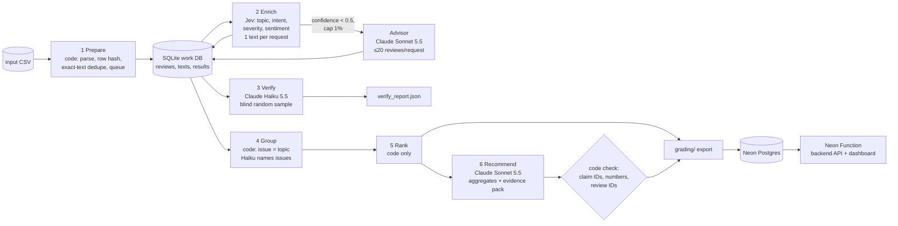

# Spotify Insight Pipeline (Final Assignment)

**Question:** At the end of the review window (May 2022 – Nov 2023), where should Spotify put the next quarter of product effort?
**Answer:** see the [decision memo](runs/full/out/memo.md) and the **live dashboard: https://br-round-shadow-b4txucoz-spotifydash.compute.c-6.us-east-2.aws.neon.tech/** (public, no login).

The pipeline is a multi-agent chain coordinated by code. **TypeSafe Jev** classifies each distinct review text. A **Claude Sonnet 5.5 advisor**, capped at 1%, re-labels low-confidence cases. A blind **Claude Haiku 5.5 verifier** re-checks a random sample. **Claude Haiku 5.5** names the issues, and **Claude Sonnet 5.5** writes the memo from saved aggregates only. Code owns record accounting, caching, budgets, ranking arithmetic and every check.

## Results summary

<!-- RESULTS:START -->
_Filled in after the final run._
<!-- RESULTS:END -->

## Rubric → evidence map

| Criterion | Evidence |
|---|---|
| **D1** Accessible code, setup, artifacts | [Setup](#setup), [pipeline/](pipeline/), [grading/](grading/), [cost/](cost/), [dashboard/](dashboard/) |
| **D2** Architecture, shared schema, provenance | [Architecture](#architecture), [pipeline/labels.py](pipeline/labels.py) (prompts and label definitions), [pipeline/contract.py](pipeline/contract.py) (row hash = course helper), `label_config` on every record and call |
| **D3** Memo numbers linked to calculations and evidence | [runs/full/out/memo.md](runs/full/out/memo.md) cites `claims.csv` IDs; [memo_check.json](runs/full/out/memo_check.json) is the code check; [grading/claims.csv](grading/claims.csv) |
| **D4** Recommendation, alternatives, limitations | [memo.md](runs/full/out/memo.md), [Limitations](#limitations) |
| **T1** 50 human labels, per-field comparison, error analysis | [evals/golden_labels.csv](evals/golden_labels.csv), [evals/golden_report.json](evals/golden_report.json), [Evaluation](#evaluation) |
| **T2** Independent verification, planted-error and injection tests | [runs/full/verify_report.json](runs/full/verify_report.json), [evals/system_tests.json](evals/system_tests.json) |
| **T3** Real 100-review cold/warm pilot, offline calculator, retry/spend/recovery controls | [cost/report.md](cost/report.md), [cost/calculator.py](cost/calculator.py), [Controls](#retry-spending-and-recovery-controls) |
| **W1** Full ingestion, record coverage, classification | [grading/ingestion.json](grading/ingestion.json), [grading/records.jsonl.gz](grading/records.jsonl.gz), [Scope](#scope) |
| **W2** Staged program, bounded calls, saved handoffs, resume | [pipeline/run.py](pipeline/run.py), [grading/calls.jsonl](grading/calls.jsonl), [checkpoints](grading/), [recording](evidence/resume_demo.mp4) |
| **W3** Reproducible ranking, deployed dashboard + backend + DB, grounded AI recommendation | `python -m pipeline.downstream rank` (no model), [dashboard/](dashboard/), Neon Postgres, [live URL](https://br-round-shadow-b4txucoz-spotifydash.compute.c-6.us-east-2.aws.neon.tech/) |

## Architecture



| Stage | Owner | Input → output | Failure behavior / stop rule |
|---|---|---|---|
| 1 Prepare | code ([prepare.py](pipeline/prepare.py)) | CSV → `reviews`, `texts`, ingestion report | Malformed CSV stops the run. Empty text is quarantined (`empty_review_text`). |
| 2 Enrich | Jev, plus capped Claude advisor ([enrich.py](pipeline/enrich.py)) | pending distinct texts → validated `results` rows, committed one by one | Invalid output is retried once. The SDK backs off on API errors. 15 consecutive failures trip a circuit breaker. A spend reservation must fit the budget before each dispatch. |
| 3 Verify | Claude Haiku ([verify.py](pipeline/verify.py)) | seeded random sample, without the first prediction → verifier labels + disagreement report | Unknown IDs are rejected. A failed batch is logged and skipped. |
| 4 Group | code + Claude Haiku names ([downstream.py](pipeline/downstream.py)) | complaint/cancellation records → `membership.csv`, `issues.json` | Names are cached by an input hash. Unknown issue IDs are rejected. |
| 5 Rank | code | records + membership → `ranking.csv`, `claims.csv` | Deterministic, with no model involved. |
| 6 Recommend | Claude Sonnet + code check | ranking, claims, issue names, ≤8 quotes per top issue → `memo.md`, `memo_check.json` | Cached by an input hash. The check lists any number or ID that does not match. |
| Serve | Neon Function ([dashboard/src/index.mjs](dashboard/src/index.mjs)) | Postgres tables → JSON API + dashboard page | Read-only. Never calls a model. |

**Why each model call exists.** Jev handles the fixed-choice decisions (8 topics, 5 intents, 5 severities, plus a 5-level sentiment score). It returns calibrated-looking probabilities that drive the advisor route, it is cheap per call, and output tokens are free. Sonnet is used only where language judgment is uncertain (≤1%) and for the one memo. Haiku handles bounded batch tasks (verification, naming). **Code does everything else:** dedupe and caching, the evidence quote (a short review's full text, or the sentence that matches the chosen topic's terms, which is always an exact substring), entity extraction (a keyword dictionary), validation, accounting, ranking arithmetic, and checking cited numbers.

## Shared labels and examples

Definitions are copied from `GRADING_CONTRACT.md` into the Jev questions in [pipeline/labels.py](pipeline/labels.py) (`PROMPT_VERSION=jevq-v1`). The label config on every record is `jev-1.13.0+jevq-v1+schema-v1+advisor:claude-sonnet-5-5@0.5`.

| Review (abridged) | topic | intent | severity | Why |
|---|---|---|---|---|
| "Please stop with the recommendations! … I'll start using Amazon music or apple if you don't." | catalog | cancellation | 3 | Threatens to leave, which takes precedence over complaint. The problem is unwanted recommendations, a degraded function. |
| "There is some bugs like music adjustment doesn't work properly" | usability | complaint | 3 | A control is degraded but the app is still usable. |
| "One of the best apps in my life :)" | other | praise | 1 | General praise with no specific feature. |
| "paying for subscribing but unable to play in offline mode really?" | downloads | complaint | 3–4 | Offline listening fails. A paid-plan mention alone is not billing. |
| "We are boycotting Swedish app in our protest against Sweden…" | other | unclear | 1 | A bare boycott slogan without a product complaint. |

## Scope

All **660,622** source IDs are accounted for in [grading/records.jsonl.gz](grading/records.jsonl.gz), each with the exact source-row hash from the course `row_sha` helper.

- **Classified:** a seeded random sample of **66,079 distinct texts**, plus every golden-50 text, chosen so that classified records cover **100,000 review IDs**. Identical texts reuse one validated result through `cache_source_id`.
- **Quarantined:** the 13 empty texts (`empty_review_text`). All other rows are `not_classified_outside_budget_scope`.
- **Why:** on Oct 6 the instructor announced that classifying at least 100,000 reviews is acceptable, and that about $10 is a reasonable API spend for that scope. The measured projection for the whole corpus is in [cost/report.md](cost/report.md) (≈ $34 base case, ≈ 7.6 h). The pipeline itself runs on any CSV: drop `--target-ids` to classify everything.
- **Checker effect:** `check_submission.py` still expects all 660,609 nonempty texts. It reports `unfinished_classification` for the out-of-scope rows, which is disclosed rather than hidden.

## Setup

```bash
# Python 3.12+ and uv (https://docs.astral.sh/uv/)
uv venv .venv && uv pip install --python .venv/bin/python anthropic typesafe-sdk python-dotenv openpyxl "psycopg[binary]" imageio-ffmpeg
cp .env.example .env   # fill only the keys you use; never commit .env
```

Place the course dataset (Google Drive ZIP, 11 files) in `data/`. The full CSV is not committed: `spotify_reviews_18months.csv`, SHA-256 `1fc85de68a304dd8978b537cfa58793d5f41cbaf417fa32cb53899f83a2fcef6`.

### Commands

| Purpose | Command | Model calls? |
|---|---|---|
| Offline cost replay (default) | `.venv/bin/python cost/calculator.py` (`--rates-multiplier 2` to test) | **No** |
| Regenerate ranking from saved outputs | `.venv/bin/python -m pipeline.downstream rank --db work/full.db --out-dir /tmp/rerank` | **No** |
| Zero-API grading check | `cd data && python3 check_submission.py check --reference ../work/local-reference.json --submission ../grading --out ../work/self-check.json` | **No** |
| Golden evaluation | `.venv/bin/python -m evals.golden --xlsx labeling/golden50_labeling_ja.xlsx --db work/full.db` | **No** |
| Offline system tests | `.venv/bin/python -m evals.system_tests --offline` | **No** |
| Paid 100-review pilot (explicit) | `.venv/bin/python cost/calculator.py --run-pilot` | Yes (≈ $0.04) |
| Full pipeline on any CSV | `.venv/bin/python -m pipeline.run --input <csv> --db work/x.db --run-dir runs/x --budget 5 --workers 4 [--target-ids N]` | Yes |
| Resume after interruption | `scripts/resume_full.sh` | Yes, only for pending texts |
| Load results into Postgres | `.venv/bin/python -m pipeline.load_db --db work/full.db --run-dir runs/full` | No |
| Deploy dashboard | `cd dashboard && npm ci && npm run build && npx neon functions deploy spotifydash --src dist/index.mjs --no-bundle` | No |

## Retry, spending and recovery controls

- **Budget:** every request reserves its worst-case cost first ([runtime.py](pipeline/runtime.py)). Work stops when spent + reserved + the next reservation would exceed `--budget`. Spend recorded in `calls.jsonl` counts again on resume. The tested refusal is in [evals/system_tests.json](evals/system_tests.json).
- **Rate:** a shared limiter (18 req/s) applies across 4 workers. Concurrency was measured stepwise: 1 worker on the pilot (7.2 texts/s), 2 on the 500 checkpoint (12.8/s), 4 on the full run (≈17.5/s, at the cap).
- **Retries:** invalid output is retried once. The SDK backs off with jitter on API errors. A circuit breaker trips after 15 consecutive failures. Every failed attempt is logged with `outcome:"failed"`.
- **Recovery:** each validated result is committed to SQLite immediately (main thread is the single writer). Reruns skip every `(text, label_config)` already saved. The full run was stopped after 10,000 texts ([checkpoint_before.json](grading/checkpoint_before.json)), then resumed with `--phase resume`. During the [recording](evidence/resume_demo.mp4) it was interrupted again with Ctrl+C and resumed a second time. The resume never re-sent a completed text ([checkpoint_after.json](grading/checkpoint_after.json)).

## Evaluation

<!-- EVAL:START -->
_Filled in after the golden labels and final run._
<!-- EVAL:END -->

## Limitations

- Classification covers 100,000 of 660,609 nonempty reviews (a seeded random sample of distinct texts). Shares are sample estimates, and short repeated texts such as "good" are weighted by how often they occur.
- Issues are coarse: one issue per primary topic. A finer grouping (sub-issues such as ads frequency or skip limits) would make the recommendation more actionable.
- Reviews are self-selected, historical and public. Cancellation language is stated intent, not churn. There is no revenue, plan tier or causal evidence.
- Jev pricing comes from third-party listings and should be reconciled with the TypeSafe dashboard. Failed calls have unknown usage, recorded as `null` rather than zero.
- The 50 golden labels are a small diagnostic sample from one labeler.
